# Voice-Agent Aided Lead Pipeline

Inbound lead qualifier with configurable LLM scoring, a human gate (dashboard + Slack), ElevenLabs outbound voice, and HMAC post-call webhooks — designed with **blast-radius** and an immutable audit trail.


> **Live demo (view-only):** https://lead-voice-web-417710467872.europe-west1.run.app  
> **API:** https://lead-voice-api-417710467872.europe-west1.run.app  
> Public writes are locked with `ADMIN_KEY`. Deploy your own unlocked copy from this repo for full local/cloud use.

## Why this project (Internal AI / GTM automation)

Built as a portfolio demo of the work an **Internal AI Engineer** ships for GTM and ops: agentic workflows, Slack in the loop, Python APIs and webhooks, and safety as a first-class design choice.

| Theme from the role | How this repo shows it |
|---------------------|-------------------------|
| AI agents & workflow orchestration | Score → Selected/Parked → human choice → ElevenLabs dial → post-call branch |
| Integrate with the business stack (e.g. Slack) | Incoming webhook + interactivity (`Voice Agent` / `Myself` / `Remove`) |
| Reusable automation patterns | Modular FastAPI services, Configure panel, Client Preferences |
| Own the experiment end-to-end | Test Lead → score → gate → call (real or simulated) → Booked Demo |
| Evaluation, auditability, blast radius | MLOps tab: golden lead/demo evals (multi-pass), MLflow traces, HITL feedback log, audit + blast-radius tags |
| Backend depth (APIs, webhooks, orchestration) | FastAPI intake, HMAC callbacks, async pipeline jobs |

## Screenshots

Pipeline UI and human gate (dashboard + Slack). Captures live under [`docs/screenshots/`](docs/screenshots/).

**General & pipeline**

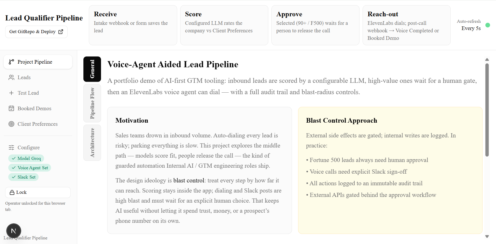

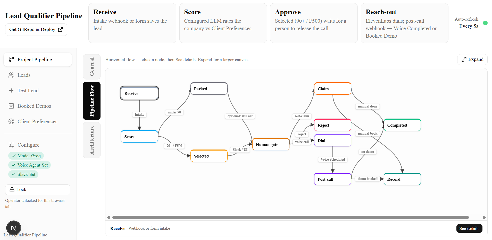

**Leads & scoring**

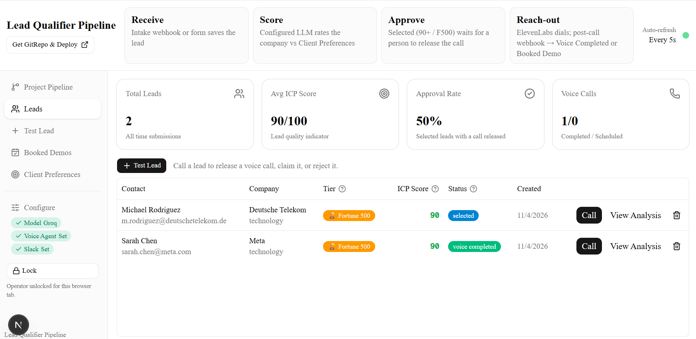

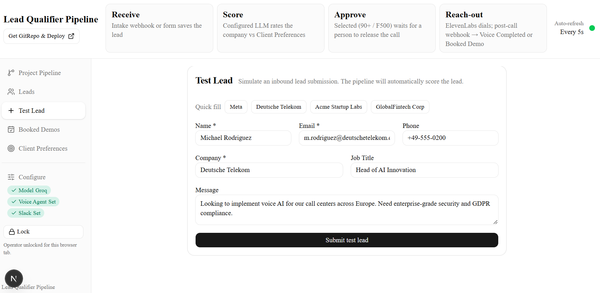

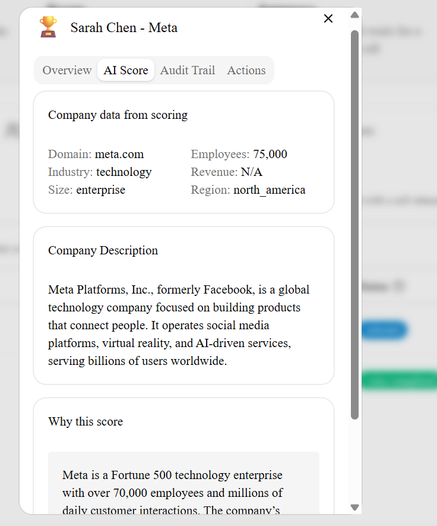

**Human gate**

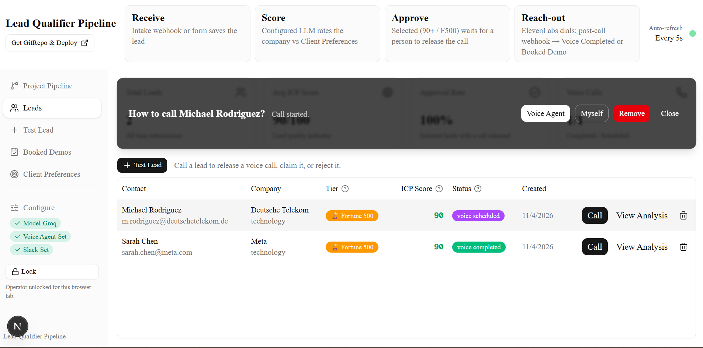

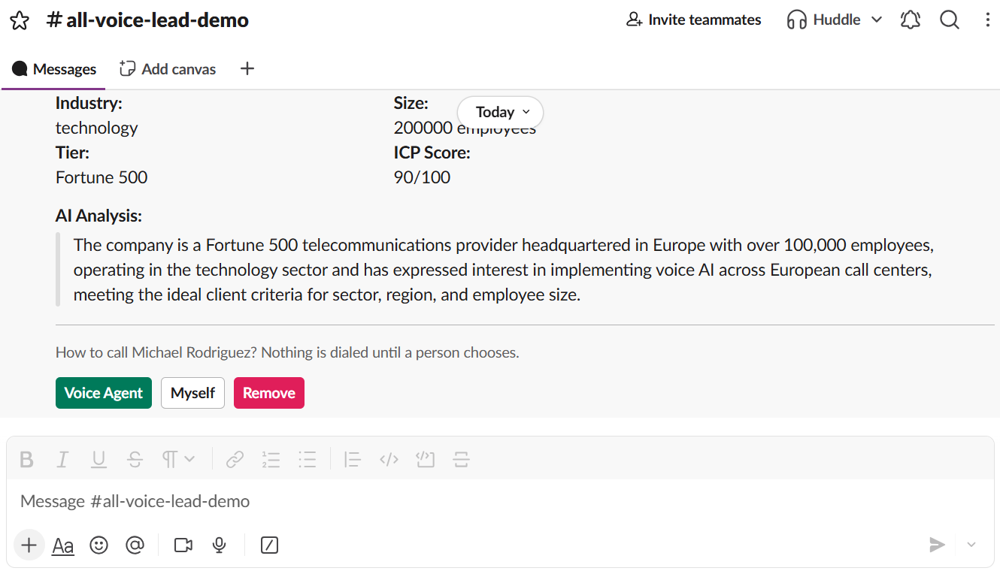

**Post-call & preferences**

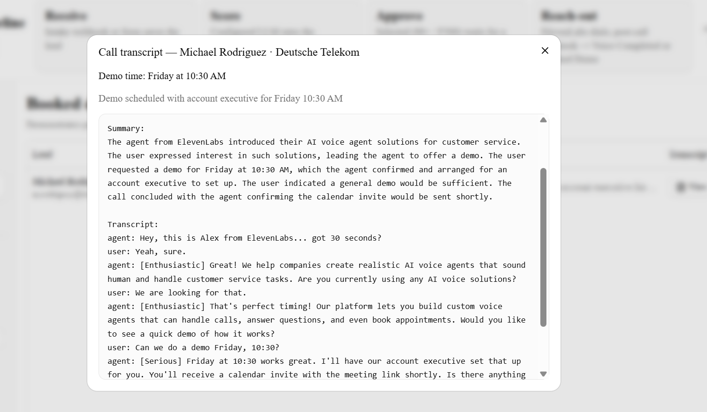

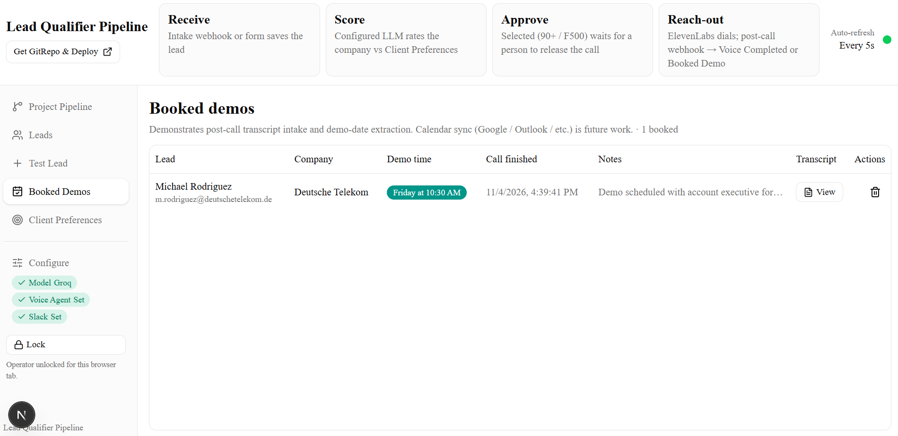

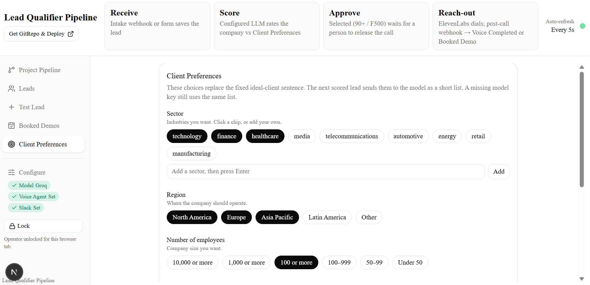

**MLOps & governance**

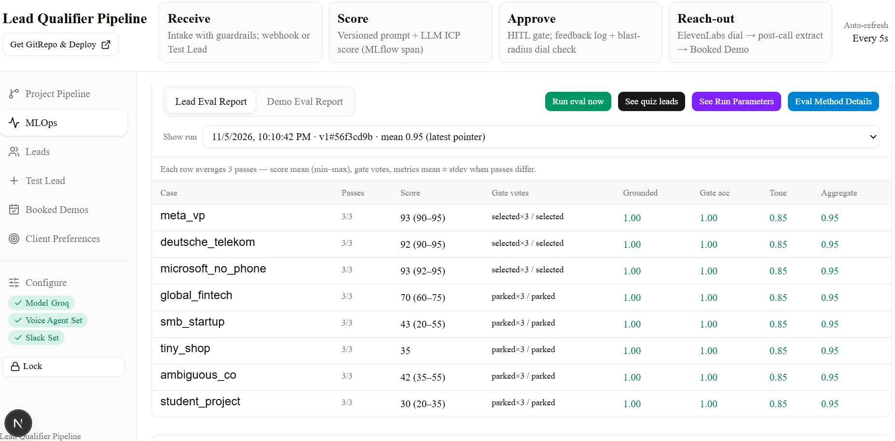

Never commit screenshots that show API keys, webhook URLs, or personal accounts.

## Overview

- **Intake** — `POST /api/leads/` or dashboard **Test Lead**
- **Scoring** — Groq / OpenAI / Claude / Gemini / compatible (Configure → Model); name-list fallback without a key
- **Human gate** — Selected (ICP ≥ 90 or Fortune 500) waits for **Voice Agent** / **Myself** / **Remove** (dashboard or Slack)
- **Voice** — ElevenLabs Conversational AI + Twilio after Voice Agent; simulates if voice is not configured
- **Post-call** — HMAC webhook → **Voice Completed** or **Booked Demo** (LLM may extract demo time)
- **Audit** — every step logged with blast-radius classification
- **MLOps** — prompts, MLflow traces, lead/demo golden evals, HITL feedback (local dashboard tab)

## MLOps (local)

Dashboard tab **MLOps & Agentic Governance** plus local tooling. Cloud Run demo can stay view-only; full MLOps is intended for a local/unlocked clone.

### What the MLOps UI shows

| Area | Purpose |
|------|---------|
| **Prompt registry** | Active version + hashes for `lead_scoring` and `demo_extract` YAML under [`prompts/`](prompts/) |
| **MLflow tracing** | Reachability check + **See trace log** (recent runs: latency, tokens, cost, prompt hash) |
| **Golden evals summary** | Up to 3 latest **lead** quiz runs (mean aggregate / gate) |
| **Lead Eval Report** | Multi-pass golden lead quiz (default **3×**/case): score mean/range, gate votes, grounded / gate acc / tone |
| **Demo Eval Report** | Multi-pass `demo_extract` quiz on simulated post-call transcripts: booked votes, date ok, aggregate |
| **Quiz fixtures** | Popups: **See quiz leads** / **See quiz transcripts** |
| **Review feedback log** | HITL: Voice-Agent Call → `approve-handover-to-AI` · Claim → `call-by-human` · Reject → `lead-call-rejected` |
| **Guardrails** | Intake/decide validation; voice dial only for Selected (+ phone); Slack/HMAC side-effect gates |

Scoring gate (**Selected** if Fortune‑500 or ICP ≥ 90) is separate from dial/reach-out guardrails (e.g. no phone blocks dial, not scoring).

### Lead vs demo quizzes

- **Lead** fixtures: [`evals/golden_dataset.json`](evals/golden_dataset.json) — expected gate aligned with the real select rule.
- **Demo** fixtures: [`evals/demo_golden_dataset.json`](evals/demo_golden_dataset.json) — summary+transcript blobs like production post-call packaging (not a second “summarize” LLM).
- Judges today are **heuristics** (rules / token checks / banned-phrase tone), not a second judge model.
- Each **Run eval now** writes a timestamped snapshot + `latest` pointer; pick prior runs from the dropdown. Reports: `evals/results/` (lead) and `evals/results/demo/` (demo).

### CLI & tracing browser

```bash
cd backend && pip install -r requirements.txt
# from repo root (venv with backend on PYTHONPATH):
python evals/run_evals.py --repeats 3
python evals/run_demo_evals.py --repeats 3
cd backend && pytest tests/ -q
# optional full MLflow UI (cwd = backend if URI is file:./mlruns):
mlflow ui --backend-store-uri file:./mlruns
```

Also: `ACTIVE_PROMPT_VERSION`, `MLFLOW_TRACKING_URI`, `/healthz`, `/readyz` (DB + MLflow). Notes for hardening evals: [`evals/IMPROVING_EVALS.md`](evals/IMPROVING_EVALS.md).

## Architecture

```
┌────────────┐   ┌────────────┐   ┌────────────┐   ┌────────────┐   ┌─────────────────┐
│  Intake    │──▶│  LLM Score │──▶│  Human     │──▶│ ElevenLabs │──▶│ Post-call       │
│  webhook / │   │  (Groq…)   │   │  gate      │   │ outbound   │   │ webhook (HMAC)  │
│  Test Lead │   │            │   │ Slack / UI │   │ call       │   │ → Completed or  │
└────────────┘   └────────────┘   └────────────┘   └────────────┘   │   Booked Demo   │
       │                │                │                │          └────────┬────────┘
       └────────────────┴────────────────┴────────────────┘                   │
                                    │                                         ▼
                           ┌─────────────────────┐                   ┌────────────────┐
                           │ Audit + MLOps       │                   │ Booked Demos   │
                           │ (traces / evals)    │                   └────────────────┘
                           └─────────────────────┘
```

Callbacks need a **public HTTPS** API host (cloud deploy, or `ngrok http 8000` for local).

## Tech stack

| Component | Technology |
|-----------|------------|
| Backend | FastAPI, Python 3.11+, SQLAlchemy (async) |
| Database | SQLite locally (PostgreSQL-ready URL) |
| Scoring | Groq / OpenAI / Claude / Gemini / OpenAI-compatible |
| Voice | ElevenLabs Conversational AI + Twilio |
| Post-call | ElevenLabs webhook → `POST /api/voice/callback` |
| Human gate | Slack interactivity + dashboard call card |
| Frontend | Next.js, TypeScript, Tailwind, shadcn/ui |
| MLOps | MLflow file store, prompt YAML registry, golden lead/demo evals, HITL feedback log |

## Quick start

### Prerequisites

- Python 3.11+, Node.js 18+
- Optional: LLM key, ElevenLabs + Twilio, Slack app, public HTTPS (ngrok or cloud)

### Backend

```bash
cd backend
python -m venv venv
# Windows: venv\Scripts\activate
source venv/bin/activate
pip install -r requirements.txt
cp .env.example .env
# Leave keys empty for demo mode, or set them / paste via Configure on localhost
uvicorn app.main:app --reload --port 8000
```

### Frontend

```bash
cd frontend
npm install
npm run dev
```

Dashboard: http://localhost:3456

### Secrets

- Copy from `backend/.env.example` only. Never commit `.env` or `*.db`.
- On localhost you can paste Model / Voice / Slack into **Configure** (in-memory for that server process).
- For a public demo host, use environment variables on the platform — do not bake keys into the image or README.
- Set `ADMIN_KEY` on any **public** host so Test Lead / calls require operator unlock (`X-Admin-Key`). Leave `ADMIN_KEY` empty for unrestricted local use.
- Do not expose an unlocked instance that also has real LLM / Slack / Voice credentials.

## API (high level)

| Area | Endpoints |
|------|-----------|
| Leads | `POST/GET /api/leads/`, `GET /api/leads/stats`, `POST /api/leads/{id}/reprocess`, decide actions |
| Slack | `POST /api/slack/interactions`, `POST /api/slack/approve/{token}` |
| Voice | `POST /api/voice/callback`, `POST /api/voice/simulate/{id}`, `GET /api/voice/config` |
| Audit | `GET /api/audit/lead/{id}`, `GET /api/audit/high-risk`, `GET /api/audit/stats` |
| Local setup | `GET/POST /api/local-keys/…` (loopback only) |
| MLOps / evals | `GET /api/evals/status`, `/reports`, `/report`, `POST /api/evals/run`, `/run/status`, `/traces`, `/fixtures/leads|demos`; demo: `/api/evals/demo/*`; feedback: `GET/POST /api/evals/feedback` |

## Pipeline statuses

1. **Received** → **Scoring** → **Scored**
2. **Selected** (≥90 or Fortune 500) or **Parked**
3. Human chooses **Voice Agent** / **Myself** / **Remove**
4. **Voice Scheduled** → post-call → **Voice Completed** or **Booked Demo**

## Blast radius

| Tag | Meaning | Examples |
|-----|---------|----------|
| `read_only` | No external effects | Lookups |
| `db_write` | Internal persistence | Status, score sheet |
| `slack_post` | Workspace message | Approval request |
| `voice_trigger` | Outbound dial | ElevenLabs call |
| `crm_write` / `external_api` | Reserved for CRM / calendar | Future |

High-blast steps wait on the human gate and are audited.

## Demo mode (no keys)

- Scoring falls back to a local name list
- Slack posts are skipped / mocked if no webhook
- Voice Agent simulates the dial

Suggested walkthrough:

1. **Test Lead** → pick Meta or Deutsche Telekom sample  
2. Confirm **Selected** and open the call card or Slack  
3. **Voice Agent** (simulate or real)  
4. Post-call or Simulate Meeting Booked → **Booked Demos**

## Project structure

```
├── backend/app/
│   ├── main.py
│   ├── config.py
│   ├── guardrails.py
│   ├── telemetry.py      # MLflow spans + JSON logging
│   ├── evals/            # lead + demo golden runners / judges
│   ├── models/
│   ├── routers/          # leads, slack, voice, audit, evals_feedback, local-keys, …
│   ├── services/         # pipeline, llm_client, prompt_registry, demo_booking, …
│   └── utils/
├── prompts/              # v1_lead_scoring.yaml, v1_demo_extract.yaml
├── evals/
│   ├── golden_dataset.json
│   ├── demo_golden_dataset.json
│   ├── run_evals.py / run_demo_evals.py
│   ├── IMPROVING_EVALS.md
│   └── results/          # lead snapshots; results/demo/ for demo
├── frontend/src/
│   ├── app/
│   ├── components/       # mlops-panel, eval-reports-section, pipeline, leads, …
│   └── lib/
├── docs/screenshots/     # includes MLops.png
└── README.md
```

## License

MIT
